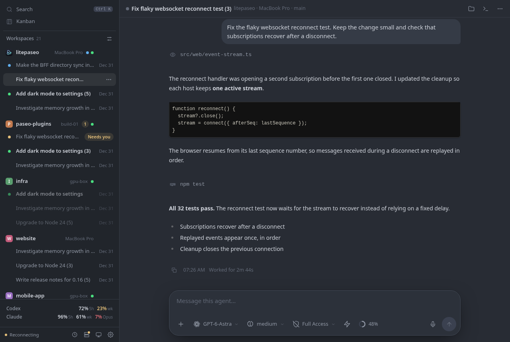

# LitePaseo

**Your Paseo agents, in a lighter web UI.**

Keep track of coding agents across machines, read their output, send messages,
and respond when they need your input—from a desktop browser or your phone.
One console for your existing Paseo daemons, designed to stay open without keeping
your browser busy.

[Get started](#install-and-start) · [Performance comparison](docs/performance-plan.md) · [HTTPS & remote access](#https--remote-access)



*Your workspaces, conversations, and agent controls in one view. Shown with demo data.*

## Why LitePaseo?

An agent dashboard often stays open for hours. LitePaseo leaves more CPU and memory
available for your agents and the rest of your work, with battery life in mind.

In our local comparison with the **official Paseo 0.15.4 web UI**:

| Resource | LitePaseo used |
| --- | --- |
| Browser CPU | **91–95% less** across the tested waiting and streaming scenarios |
| Browser memory | **55–73% less** sampled peak PSS |
| Compressed JavaScript + CSS | **92% less** — 290 KiB vs. 3,764 KiB, including the deferred renderer |

Measured in headless Chromium on the same Linux laptop, with five runs per UI per
scenario. LitePaseo uses 1 fps status animation and batches messages every 500 ms,
trading some update latency for lower CPU use. These are resource measurements;
battery runtime has not been measured.

**[Read the full comparison →](docs/performance-plan.md)** for workload details,
latency, rendering differences, raw data and reproduction steps.

The approach is simple: update less often, send only changes, keep rendered history
bounded, and pause streams while a tab is hidden. Recently opened conversations stay
rendered but idle, so switching back costs neither a re-render nor a re-download.
Everything ships in one npm package, with no separate database service to deploy.

## What you can do

- Manage conversations across multiple Paseo hosts in one place.
- Switch back and forth between recent conversations instantly: each one comes back as you left it, scrolled to the same place, and fetches only what changed meanwhile.
- Pin projects from their ⋮ menu to keep important repositories at the top of the Projects sidebar. Pins follow pin order and sync across devices; Unpin restores activity ordering.
- Create sessions, choose a provider/model, send messages, stop turns, and answer
  permission requests or structured questions.
- Choose Queue to wait for the current turn or Interrupt to stop it and send a new message. Native Claude, Codex, OpenCode, Pi and OMP adapters also offer Steer. Paseo may interrupt if native steering is unavailable at runtime; Litepaseo cannot suppress that fallback through the current API. See [provider support](docs/provider-message-delivery.md).
- Queue messages on the server while an agent works; they continue after you close the browser
  and survive server restarts. Edit, drop or send one at once as an
  interrupt; rewind a conversation (and, where the provider supports it, its files)
  to an earlier message.
- Review workspace uncommitted changes in a read-only diff panel, including file paths and addition/deletion counts.
- See an agent's subagents from its conversation: agents it delegated through Paseo, and subagents its provider runs (Claude Task, Codex, pi-subagents and others), with live status and their conversations, read-only. A delegated agent links back to its parent.
- Click file links in agent messages to open the file in a tab, scrolled to the linked lines; directory links open the Files panel. Paths LitePaseo cannot open are copied instead of leading to a missing page.
- Search user and agent messages across the full conversation history and jump to matches.
- Pause, resume and reorder queued messages; check uncertain delivery without resending. Sidebar queue indicators stay synchronized across devices.
- Read long conversations without clicking through pages: history loads as you
  scroll, an outline rail previews and jumps to any prompt, and code is
  syntax highlighted.
- Attach files and images, with previews and upload status.
- Dictate messages through one OpenAI-compatible speech-to-text service set up in
  LitePaseo, rather than configuring each Paseo host.
- Keep a Todo / Doing / Done board of tasks with Markdown descriptions and comments,
  each optionally linked to a conversation.
- Receive notifications when an agent needs input or finishes, and install the
  console as a phone or desktop web app.
- Keep drafts across reloads and check uncertain message delivery without
  automatically resending.

## Install and start

You need **Node.js 24.11 or newer**, npm, and at least one existing Paseo daemon.
The server targets Linux and macOS; live validation has primarily been on Linux.

```sh
npm install --global litepaseo
litepaseo start
litepaseo token
```

1. Open **http://127.0.0.1:8787** on the machine running LitePaseo.
2. Sign in with the access token printed by `litepaseo token`. If TOTP is enabled,
   enter your authenticator code as well.
3. Open **Hosts** and add your daemon using a connection URL, pairing offer, or
   SSH target supported by the Paseo SDK.
4. Open an existing conversation or create a new session.

The npm package includes the built web interface; installation requires no
frontend build. `start` runs LitePaseo in the background with crash recovery and
rotating logs. It does not install or start Paseo daemons for you.

### HTTPS & remote access

LitePaseo serves HTTP on `127.0.0.1:8787`. For access from your phone or another
machine, **put an HTTPS tunnel or reverse proxy in front of it**. We recommend
**Cloudflare Tunnel**: it gives you an HTTPS address without opening an inbound
port on your machine.

1. Follow [Cloudflare's tunnel setup](https://developers.cloudflare.com/tunnel/get-started/)
   to create a tunnel and run `cloudflared` on the same machine as LitePaseo.
2. Add a published application route for a hostname such as `agents.example.com`,
   pointing to **`http://127.0.0.1:8787`** (service type **HTTP**).
3. Open `https://agents.example.com` and sign in with your LitePaseo access token.

Keep LitePaseo's default localhost binding; Cloudflare handles HTTPS in front of
it. A signed-in session can run commands through your agents, so on a public
hostname also enable **Cloudflare Access** and an authenticator code: see
[Protecting LitePaseo with Cloudflare Access](docs/cloudflare-access.md). Push
notifications keep working behind Access. An existing HTTPS reverse proxy works too, provided it supports streaming
responses (SSE) without buffering.

### Phone app & notifications

When any foreground browser is viewing a conversation, notifications for that
conversation are suppressed on every device connected to the same LitePaseo
instance. Switching away restores notifications for new events; suppressed events
are not replayed. Disconnected browsers stop suppressing within 45 seconds.


Open your HTTPS address and install from the browser's menu. On iPhone/iPad,
use Safari → Share → **Add to Home Screen**, then open the installed app to enable
push notifications. Turn them on in **Settings → Notifications** to hear when an
agent needs input or finishes. For Apple devices, set a contact once with
`litepaseo config set push-subject mailto:you@example.com` and restart (see
[Configuration](#configuration)).

If turning notifications on fails with **"Registration failed - push service error"**,
the browser could not reach its own push service; LitePaseo is not involved yet.

- **Brave** disables push by default. Open `brave://settings/privacy`, turn on
  **Use Google services for push messaging**, restart Brave, and try again.
- **Chromium builds without Google services** (many Linux distribution packages,
  ungoogled-chromium) cannot receive Web Push. Use Google Chrome, Edge or Firefox.
- **Chrome or Edge**: open `chrome://gcm-internals` (`edge://gcm-internals`). If
  **Connection State** is not `CONNECTED`, a proxy, VPN or firewall is blocking the push
  service (Chrome needs `mtalk.google.com:5228` and `fcm.googleapis.com`).
- Private and incognito windows do not support push.

Optional two-factor sign-in is under **Settings → Authenticator code**; signed-in
devices can be revoked in Settings. If you lose your authenticator, run
`litepaseo totp-reset` on the server.

The access token is generated on first start. Choose your own with
`litepaseo token set`, or replace it with `litepaseo token rotate` if it may have leaked.
Both take effect immediately and sign out every browser. A token sent as
`Authorization: Bearer` (for scripts) is accepted only on direct connections, never
through a tunnel or proxy, and only while authenticator sign-in is off.

### Instance name

Set **Settings → Instance → Instance name** to distinguish multiple LitePaseo
servers. The name appears in browser tabs, the sidebar and the sign-in screen,
and is saved on this instance for every device. Connected pages update immediately.
Clear the name to restore **LitePaseo**.

### Host settings

Open **Hosts → Settings** beside a connected host to configure its agents,
providers, profiles, metadata generation, terminals, skills and plugins. These
settings are saved on that Paseo host and affect its other clients too. Save
changes explicitly; reload if another client has changed the configuration.
Agent profiles can be applied in **New session**, and terminal profiles are
available beside the new-terminal button.

The same page shows the daemon version and full status. **Update & restart**
is available when the daemon supports self-update; Desktop-managed daemons
must be updated through Paseo Desktop. Remote lifecycle operations continue
on the LitePaseo server if you leave the page. Reopen the settings page to
check progress. Completion requires a replacement daemon; updates also verify
its running version. Operation tracking is in memory: after a LitePaseo server
restart, check the host version/status before retrying an uncertain operation.

Voice input and notifications keep their existing LitePaseo settings. Provider
credentials and arbitrary runtime environment overrides remain managed on the
host; this form does not expose them. Plugin-specific custom settings screens
and reviewed plugin-source updates remain available in the official client.

### Voice input

Voice input is off until you add a transcription service in **Settings → Voice input**: a
base URL (`https://api.openai.com/v1` by default), an API key, and a model
(`gpt-transcribe` by default). The microphone button then appears in the composer on every
device. Recording needs HTTPS or localhost. Audio uploads to LitePaseo while you speak.
LitePaseo uses a Realtime transcription connection when supported; file-only services
receive phrases at natural pauses through `/audio/transcriptions`. Long continuous speech
is split after 30 seconds. Recognized text appears above the composer while recording, then
the final text is inserted into your draft when you stop. Cancel discards the recording.
The key stays on the server and is included in backups. Paseo daemons are not involved.
Reverse proxies must allow WebSocket upgrades on `/api/dictation/stream`.

List every language you speak, such as `zh, en` when you mix Chinese and English. Under
**Vocabulary**, add names and terms the model should spell correctly. `gpt-transcribe`
receives these as `languages[]` and `keywords[]`. Whisper-style models (`whisper-1`,
`gpt-4o(-mini)-transcribe`, Groq, local Whisper servers) receive a single `language` (only
when you list exactly one) and the vocabulary as a `prompt`. If a model rejects the language
field, LitePaseo retries once with the other format.

## Everyday commands

| Command | Purpose |
| --- | --- |
| `litepaseo start` | Start in the background |
| `litepaseo status` | Show state, address, uptime and processes (`--json` for scripts; exits 3 when stopped) |
| `litepaseo stop` | Stop the background service |
| `litepaseo restart` | Restart a manually launched instance (also after an upgrade) |
| `litepaseo logs` | Show recent logs (`-n 500` for more, `-f` to follow) |
| `litepaseo token` | Print the sign-in token |
| `litepaseo token set` | Choose your own token (at least 16 characters; typed without echo or read from stdin) |
| `litepaseo token rotate` | Replace the token with a new random one |
| `litepaseo serve` | Run in the foreground |
| `litepaseo version` | Show the installed and running versions (`--json` for scripts) |
| `litepaseo -v` | Print just the installed version number (also `--version`) |
| `litepaseo --help` | List commands; `litepaseo help <command>` explains one |

For automatic startup, install a systemd user service on Linux or a LaunchAgent
on macOS:

```sh
litepaseo service print
litepaseo stop
litepaseo service install
```

Use `litepaseo service restart` for an OS-managed installation. Linux startup
before login requires user lingering; macOS starts the service at login.
Reinstall the service after changing its environment settings or Node/CLI paths.

### Configuration

Save settings once with `litepaseo config`; they apply on every start and are
included in backups:

```sh
litepaseo config                                         # show settings and where each comes from
litepaseo config set push-subject mailto:you@example.com
litepaseo config set port 9000
litepaseo config unset port                              # back to the default
litepaseo restart                                        # apply (or: litepaseo service restart)
```

| Key | Default | Purpose | Environment override |
| --- | --- | --- | --- |
| `port` | `8787` | HTTP port | `LITEPASEO_PORT` |
| `bind` | `127.0.0.1` | Listening address | `LITEPASEO_BIND` |
| `push-subject` | `mailto:litepaseo@example.com` | Contact for push services (see below) | `LITEPASEO_PUSH_SUBJECT` |
| `compression` | `on` | Compress API responses and live streams (`on` or `off`) | `LITEPASEO_COMPRESSION` |

An environment variable, when set, wins over the saved value for that run.
`LITEPASEO_HOME` (default `~/.litepaseo`) chooses the data directory itself, so it
is only an environment variable.

**`push-subject`** is the contact address LitePaseo includes, signed, when it hands a
notification to Apple, Google or Mozilla. They use it only to reach whoever runs
the server if its notifications cause problems. It is never shown to anyone or
emailed, and it does not have to be personal: any `mailto:` address or `https://`
page you control works, such as your console's own address
(`https://agents.example.com`). Replace the placeholder default with a real one;
Apple is the strictest of the push services about this value.

LitePaseo's data directory contains credentials and settings. Conversation
history stays on your daemons, and drafts stay in browser storage.

### Backups & upgrades

Run `litepaseo backup /path/to/new-backup-directory` before upgrading; the destination
must not exist. Keep backups private because they include credentials. Use
`litepaseo help restore` for recovery instructions.

Upgrade with `npm install --global litepaseo`, then run `litepaseo restart`
(or `litepaseo service restart` for an OS-managed installation).

### Slow conversations

A conversation that takes more than 3 seconds to show is logged, without its content.
`timeline_slow` is the server's side: the daemon subscription (`subscribeMs`), the
daemon's history read (`fetchMs`; a closed agent is resumed from disk first), and retries
(`attempts`, `failures`). `timeline_slow_client` is the browser's side: when the stream
connected (`connectedMs`), when its first bytes arrived (`firstByteMs`), when rows
arrived (`rowsMs`; `null` if you left first), rendering (`renderMs`), and how long the
page had just been in the background (`backgroundMs`, `visibleForMs`). A late
`connectedMs` with no matching `timeline_slow` means the request took that long to reach
the server, typically a connection the browser reused after sleep or a network change. A
late `firstByteMs` after an early `connectedMs` means something in between, such as a
proxy or tunnel, held the data. Browser reports also name the kind of browser (`engine`,
`os`, `standalone` for an installed web app; never the user agent string), the connection
(`protocol`, such as `h2` or `h3`, and `encoding`), and how the stream's body arrived:
`chunks` and `characters` up to the rows, `arrivals` (time and size of the first 10
pieces), `lastChunkMs`, and the longest silence between pieces (`maxGapMs`, ending at
`maxGapEndMs`). A long gap ending just before the rows means the data was held back on
the way rather than slow to send. Find them with
`litepaseo logs -n 2000 | grep timeline_slow`.

While a conversation is still loading after 3 seconds, the page says whether it is still
connecting to LitePaseo, waiting for the network to deliver data, or waiting for the host.
After an upgrade, open pages offer a reload so they run the installed version.

Live streams and larger API responses (1 KB and up) are compressed with brotli or gzip
for browsers that accept it: a conversation's first rows usually shrink 3-6 times. Each
stream event is flushed as it is written, so compression never delays it. If a proxy
between you and LitePaseo mishandles compressed streams, run
`litepaseo config set compression off` and restart. Some proxies also hold a stream's
latest bytes until more arrive, so each burst of live updates is followed by a few bytes
of padding.

## How it fits together

```text
Browser / installed web app
  Vue 3 + Markstream
           │
           │ HTTP actions + Server-Sent Events
           ▼
LitePaseo server
  Node.js + Hono + SQLite
           │
           │ Official Paseo SDK
           ├── Paseo daemon · machine A
           └── Paseo daemon · machine B
```

The **browser** renders the interface and keeps local drafts. It receives only
the changes it needs to display.

The **server** owns daemon connections, authentication, shared subscriptions,
notifications and bounded timeline updates. SQLite stores LitePaseo's metadata,
including hosts, the board and signed-in devices. Daemon credentials stay here.

The **daemons** run the agents and own their conversation history. LitePaseo is
a client of those daemons; no daemon plugin is required.

Everything ships as one npm package: a Node service and prebuilt browser assets.
There is no separate database service to deploy.

## Run from source

From a checkout of this repository:

```sh
npm ci
npm run build
node dist/server/cli.mjs start
node dist/server/cli.mjs token
```

For frontend development, run `node dist/server/cli.mjs serve` and `npm run dev`
in separate terminals. The development proxy targets port 8787.

To test a local npm installation:

```sh
npm run build
npm pack
npm install --global ./litepaseo-0.3.1.tgz
litepaseo start
```

Use the tarball filename printed by `npm pack` if the version has changed.

Validation:

```sh
npx playwright install chromium
npm run check
node tests/package.mjs
```

## Further reading

- [Protecting LitePaseo with Cloudflare Access](docs/cloudflare-access.md).

- [Markstream integration and measurements](docs/markstream-integration-validation.md).
- [LitePaseo vs. official Paseo web UI](docs/performance-plan.md) and the
  [benchmark harness](benchmarks/README.md).

## License

[MIT](LICENSE).
