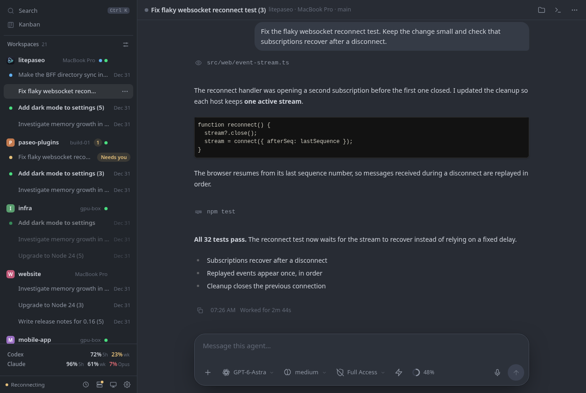

# LitePaseo

**Your Paseo agents, in a lighter web UI.**

Keep track of coding agents across machines, read their output, send messages,
and respond when they need your input—from a desktop browser or your phone.
One console for your existing Paseo daemons, designed to stay open without keeping
your browser busy.

[Get started](#install-and-start) · [Performance comparison](docs/performance-plan.md) · [HTTPS & remote access](#https--remote-access)



*Your workspaces, conversations, and agent controls in one view. Shown with demo data.*

## Why LitePaseo?

An agent dashboard often stays open for hours. LitePaseo leaves more CPU and memory
available for your agents and the rest of your work, with battery life in mind.

In our local comparison with the **official Paseo 0.15.4 web UI**:

| Resource | LitePaseo used |
| --- | --- |
| Browser CPU | **91–95% less** across the tested waiting and streaming scenarios |
| Browser memory | **55–73% less** sampled peak PSS |
| Compressed JavaScript + CSS | **92% less** — 290 KiB vs. 3,764 KiB, including the deferred renderer |

Measured in headless Chromium on the same Linux laptop, with five runs per UI per
scenario. LitePaseo uses 1 fps status animation and batches messages every 500 ms,
trading some update latency for lower CPU use. These are resource measurements;
battery runtime has not been measured.

**[Read the full comparison →](docs/performance-plan.md)** for workload details,
latency, rendering differences, raw data and reproduction steps.

The approach is simple: update less often, send only changes, keep rendered history
bounded, and pause streams while a tab is hidden. Everything ships in one npm
package, with no separate database service to deploy.

## What you can do

- Manage conversations across multiple Paseo hosts in one place.
- Create sessions, choose a provider/model, send messages, stop turns, and answer
  permission requests or structured questions.
- Attach files and images, with previews and upload status.
- Keep a Todo / Doing / Done board linked to conversations.
- Receive notifications when an agent needs input or finishes, and install the
  console as a phone or desktop web app.
- Keep drafts across reloads and check uncertain message delivery without
  automatically resending.

## Install and start

You need **Node.js 24.11 or newer**, npm, and at least one existing Paseo daemon.
The server targets Linux and macOS; live validation has primarily been on Linux.

```sh
npm install --global litepaseo
litepaseo start
litepaseo token
```

1. Open **http://127.0.0.1:8787** on the machine running LitePaseo.
2. Sign in with the access token printed by `litepaseo token`. If TOTP is enabled,
   enter your authenticator code as well.
3. Open **Hosts** and add your daemon using a connection URL, pairing offer, or
   SSH target supported by the Paseo SDK.
4. Open an existing conversation or create a new session.

The npm package includes the built web interface; installation requires no
frontend build. `start` runs LitePaseo in the background with crash recovery and
rotating logs. It does not install or start Paseo daemons for you.

### HTTPS & remote access

LitePaseo serves HTTP on `127.0.0.1:8787`. For access from your phone or another
machine, **put an HTTPS tunnel or reverse proxy in front of it**. We recommend
**Cloudflare Tunnel**: it gives you an HTTPS address without opening an inbound
port on your machine.

1. Follow [Cloudflare's tunnel setup](https://developers.cloudflare.com/tunnel/get-started/)
   to create a tunnel and run `cloudflared` on the same machine as LitePaseo.
2. Add a published application route for a hostname such as `agents.example.com`,
   pointing to **`http://127.0.0.1:8787`** (service type **HTTP**).
3. Open `https://agents.example.com` and sign in with your LitePaseo access token.

Keep LitePaseo's default localhost binding; Cloudflare handles HTTPS in front of
it. An existing HTTPS reverse proxy works too, provided it supports streaming
responses (SSE) without buffering.

### Phone app & notifications

Open your HTTPS address and install from the browser's menu. On iPhone/iPad,
use Safari → Share → **Add to Home Screen**, then open the installed app to enable
push notifications. Turn them on in **Settings → Notifications** to hear when an
agent needs input or finishes. Set `LITEPASEO_PUSH_SUBJECT=mailto:you@example.com`
before starting the server for Apple push delivery.

Optional two-factor sign-in is under **Settings → Authenticator code**; signed-in
devices can be revoked in Settings. If you lose your authenticator, run
`litepaseo totp-reset` on the server.

## Everyday commands

| Command | Purpose |
| --- | --- |
| `litepaseo start` | Start in the background |
| `litepaseo status` | Show state, address, uptime and processes (`--json` for scripts; exits 3 when stopped) |
| `litepaseo stop` | Stop the background service |
| `litepaseo restart` | Restart a manually launched instance (also after an upgrade) |
| `litepaseo logs` | Show recent logs (`-n 500` for more, `-f` to follow) |
| `litepaseo token` | Print the sign-in token |
| `litepaseo serve` | Run in the foreground |
| `litepaseo version` | Show the installed and running versions (`-v` prints just the number) |
| `litepaseo --help` | List commands; `litepaseo help <command>` explains one |

For automatic startup, install a systemd user service on Linux or a LaunchAgent
on macOS:

```sh
litepaseo service print
litepaseo stop
litepaseo service install
```

Use `litepaseo service restart` for an OS-managed installation. Linux startup
before login requires user lingering; macOS starts the service at login.
Reinstall the service after changing its environment settings or Node/CLI paths.

### Configuration

Set these variables before starting LitePaseo:

| Variable | Default | Purpose |
| --- | --- | --- |
| `LITEPASEO_PORT` | `8787` | HTTP port |
| `LITEPASEO_BIND` | `127.0.0.1` | Listening address |
| `LITEPASEO_HOME` | `~/.litepaseo` | Application data directory |
| `LITEPASEO_PUSH_SUBJECT` | — | Contact URL or `mailto:` address for push services |

For example:

```sh
LITEPASEO_PORT=9000 litepaseo start
```

LitePaseo's data directory contains credentials and settings. Conversation
history stays on your daemons, and drafts stay in browser storage.

### Backups & upgrades

Run `litepaseo backup /path/to/new-backup-directory` before upgrading; the destination
must not exist. Keep backups private because they include credentials. Use
`litepaseo help restore` for recovery instructions.

Upgrade with `npm install --global litepaseo`, then run `litepaseo restart`
(or `litepaseo service restart` for an OS-managed installation).

## How it fits together

```text
Browser / installed web app
  Vue 3 + Markstream
           │
           │ HTTP actions + Server-Sent Events
           ▼
LitePaseo server
  Node.js + Hono + SQLite
           │
           │ Official Paseo SDK
           ├── Paseo daemon · machine A
           └── Paseo daemon · machine B
```

The **browser** renders the interface and keeps local drafts. It receives only
the changes it needs to display.

The **server** owns daemon connections, authentication, shared subscriptions,
notifications and bounded timeline updates. SQLite stores LitePaseo's metadata,
including hosts, the board and signed-in devices. Daemon credentials stay here.

The **daemons** run the agents and own their conversation history. LitePaseo is
a client of those daemons; no daemon plugin is required.

Everything ships as one npm package: a Node service and prebuilt browser assets.
There is no separate database service to deploy.

## Run from source

From a checkout of this repository:

```sh
npm ci
npm run build
node dist/server/cli.mjs start
node dist/server/cli.mjs token
```

For frontend development, run `node dist/server/cli.mjs serve` and `npm run dev`
in separate terminals. The development proxy targets port 8787.

To test a local npm installation:

```sh
npm run build
npm pack
npm install --global ./litepaseo-0.3.0.tgz
litepaseo start
```

Use the tarball filename printed by `npm pack` if the version has changed.

Validation:

```sh
npx playwright install chromium
npm run check
node tests/package.mjs
```

## Further reading

- [Markstream integration and measurements](docs/markstream-integration-validation.md).
- [LitePaseo vs. official Paseo web UI](docs/performance-plan.md) and the
  [benchmark harness](benchmarks/README.md).

## License

[MIT](LICENSE).
